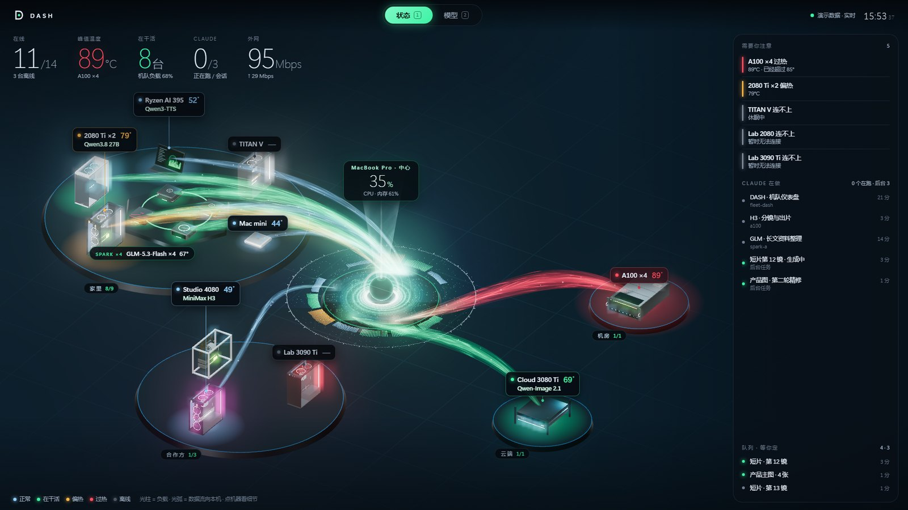
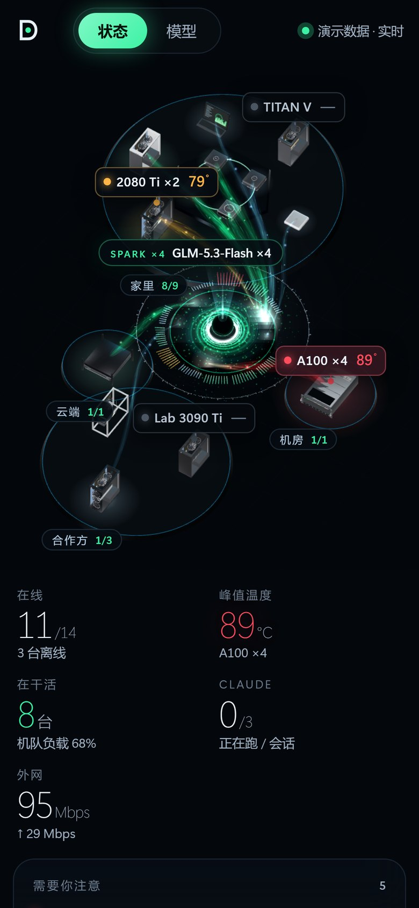

# DASH — a 3D dashboard for your home GPU / AI fleet

[中文说明](README.zh-CN.md)



DASH turns a pile of GPU boxes (GB10 mini PCs, an A100 server, gaming towers, a laptop, a cloud VM…) into one live 3D scene you can open on a phone. Every machine is a real-proportion 3D model standing on its site's island; a bundle of light fibres runs from each one into a glowing "universe centre", thicker when the machine works harder, coloured by its state. Tap any machine to fly in and see its GPUs, temperatures and what it is running. On the model page you can switch what a GPU box serves (one LLM vs. another, video vs. image generation) with a press-and-hold.

It runs a real 14-machine fleet across home, a campus server room, a cloud VM and a partner's machines. The repo ships with a made-up demo fleet so you can try it in a minute.

## What you get

- **3D hangar** — Three.js, PBR models generated in Blender (`assets3d/`), soft shadows, bloom, a quasar-style centre (accretion disk, jet, star dust), per-machine 45-minute temperature spikes.
- **Orbit like a 3D viewer** — drag to rotate 360°, wheel / pinch to zoom, right-drag / two fingers to pan, double-click to reset. Input drives a target and the camera eases toward it, so motion stays smooth even when pointer events and screen refresh don't line up.
- **Tap a machine → detail** — desktop: a side panel; phone: the 3D view expands to full screen from where it was and the camera flies to that machine. Swipe or ‹ › to go through machines.
- **Labels that stay readable** — solid chips with leader lines, snapped to device pixels (no shimmer while rotating), with screen-space collision avoidance against each other, other machines and the UI.
- **Model switchboard** — every switch is a whitelisted command in the hub's config; the relay and the browser only ever see an option id. Confirmation text, ETA, progress and result come back live.
- **Agentless probes** — the hub reaches each machine with SSH (or any command you give it) and runs a small script over stdin: CPU, memory, disk, temperatures, `nvidia-smi` GPUs, listening ports. Linux, macOS, Windows (NVIDIA and integrated AMD).
- **Adaptive quality** — no MSAA on high-DPI screens, half-resolution bloom, and automatic step-down when frames get slow. Measured 60 fps (16.7 ms median, 18 ms p95) while rotating on an M3 Pro MacBook; it was 33 / 50 ms before these changes.
- **Optional feeds** — live Claude Code sessions on the hub machine, plus any task / queue list your own scripts can print as JSON.

The UI text is Chinese (simplified). PRs for other languages are welcome.

| Phone | |
|---|---|
|  | Status page with machines grouped by site, a list of what needs attention, tap-to-detail. The phone layout stacks the 3D view on top and cards below. |

## Try the demo (1 minute)

Needs Node 18+ and Python 3 (only for a static file server).

```bash
node web/src/build.mjs                    # → web/dist
python3 -m http.server -d web/dist 8080
# open http://localhost:8080/?mock=1
```

`?mock=1` plays a made-up 14-machine fleet from `web/mock/state.json`, including fake model switches.

## Run it on your own fleet

```
 machines ──ssh──▶ hub (hub/hub.py, on an always-on box) ──HTTPS──▶ relay (relay/relay.mjs, behind your reverse proxy) ──▶ browser
```

1. **Relay** (Node 18+, no dependencies) on a server your browser can reach:

   ```bash
   export HUB_TOKEN=$(openssl rand -hex 32)          # keep it, the hub needs the same value
   DATA_DIR=./data PORT=8941 node relay/relay.mjs     # listens on 127.0.0.1:8941
   ```

2. **Web** — `node web/src/build.mjs`, then serve `web/dist` and the relay from the same origin. The relay's `/api/*` has **no auth of its own**: put it behind your reverse proxy's login. `/ingest/*` is authenticated with the hub token. Example Caddyfile:

   ```caddyfile
   dash.example.com {
     handle /ingest/* {
       reverse_proxy 127.0.0.1:8941
     }
     handle {
       basic_auth {
         you $2a$14$REPLACE_WITH_caddy_hash-password_OUTPUT
       }
       handle /api/* {
         reverse_proxy 127.0.0.1:8941 {
           flush_interval -1
         }
       }
       handle {
         root * /srv/dash/web/dist
         file_server
       }
     }
   }
   ```

3. **Hub** (Python 3.8+, standard library only) on a machine that can SSH into the others:

   ```bash
   cp hub/fleet.example.json hub/fleet.json            # describe your machines, cards and switch commands
   python3 hub/hub.py --once                            # probe once and print the snapshot
   mkdir -p ~/.config/fleetdash && echo "$HUB_TOKEN" > ~/.config/fleetdash/hub_token && chmod 600 ~/.config/fleetdash/hub_token
   FLEETDASH_RELAY=https://dash.example.com python3 hub/hub.py
   ```

   On macOS, `FLEETDASH_RELAY=https://dash.example.com bash hub/install-macos.sh` installs it as a LaunchAgent.

   Windows machines need OpenSSH server with PowerShell as the default shell (or a wrapper command that runs its last argument in PowerShell).

Config keys, card sources (`ports` / `command` / `gpus`), switch commands and the snapshot format: [docs/data-contract.md](docs/data-contract.md).

## Security model

- Switch commands exist only in `hub/fleet.json` on the hub machine. The relay accepts an option id only if the latest snapshot published it, refuses a second switch on a machine that is still switching, and caps the queue.
- The hub authenticates to the relay with a bearer token (≥ 32 chars, constant-time compare). The relay binds to `127.0.0.1` by default.
- The web UI and `/api/*` must sit behind your own login (basic auth, SSO, Cloudflare Access…). Don't expose the relay port directly.
- Ports and machine names you put in the config are visible to whoever can open the dashboard.

## 3D models

`web/assets/models/fleet_assets.glb` is generated, not hand-modelled:

```bash
python3 assets3d/make_textures.py                                        # tileable textures → assets3d/tex (numpy, Pillow)
blender -b --python assets3d/build_assets.py -- assets3d/tex web/assets/models [render]
```

Model names you can use per machine are listed in the data contract.

## Repo layout

```
web/        front end: index.html, js (app, scene, data), css, three.js r170 (vendored, MIT), models, demo data
relay/      tiny Node relay: snapshot in, SSE out, switch queue
hub/        collector + switch runner, example config, macOS LaunchAgent installer
assets3d/   Blender script + texture generator for the machine models
docs/       data contract, screenshots
```

## License

MIT — see [LICENSE](LICENSE). three.js is MIT, see `web/vendor/THREE-LICENSE`. Product names that appear as text on the 3D models belong to their owners; the models are stylised, not official.
