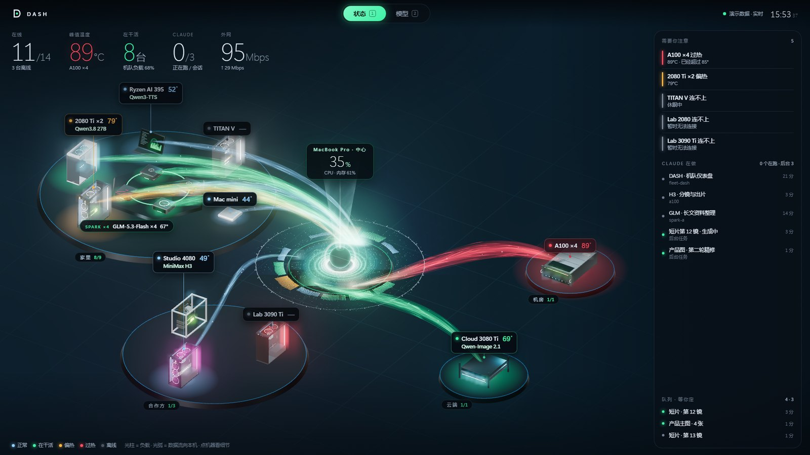
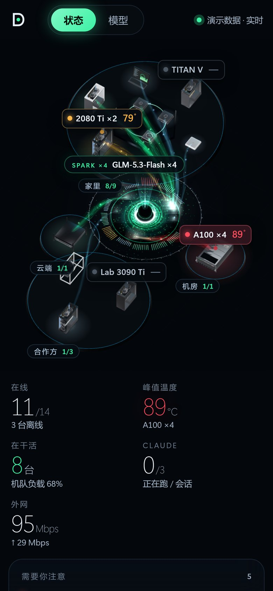

# DASH：家用 GPU / AI 机队的 3D 看板

[English](README.md)



家里几台 GB10 小主机、机房一台 A100、几台游戏塔式机、一台笔记本、一台云电脑……DASH 把它们放进同一个能在手机上打开的 3D 场景。每台机器按真实比例建模，立在所在站点的岛上；每台引出一束光纤汇进中间的「宇宙中心」：越忙越粗，颜色跟状态走。点任何一台，镜头飞过去看它的显卡、温度和正在跑什么。模型页可以按住 1 秒切换一台机器上跑的模型（换一个大模型、视频和出图互切）。

作者自己用它管着一支 14 台的真机队：家里、园区机房、云端，加上合作方的几台。仓库里带的是一支虚构的演示机队，一分钟就能跑起来看。

## 有什么

- **3D 机库**：Three.js，机器模型用 Blender 脚本程序化生成（`assets3d/`），PBR 材质、软阴影、辉光。中心是吸积盘、喷流加星尘的「宇宙中心」，外圈是每台机器最近 45 分钟的温度尖刺。
- **像 3D 查看器一样转**：拖动 360° 旋转，滚轮或双指缩放，右键或双指平移，双击复位。输入只改目标位置，镜头平滑追过去；鼠标事件和屏幕刷新对不齐时，也不会一帧动一帧停。
- **点机器看详情**：电脑上右侧出详情面板；手机上 3D 区从原位置展开成整屏，镜头飞到那台机器。左右滑或点 ‹ › 换一台。
- **标签看得清**：实底小牌加引线，位置按设备像素取整，转动时字不闪；屏幕空间自动避让，不互相压，不压别的机器，也不压页面上的面板。
- **模型切换台**：每个切换都是 hub 配置里白名单内的一条命令，中继和浏览器只看得到选项 id。确认文案、预计时间、进度和结果实时回来。
- **不用装 agent**：hub 用 SSH（或你给的任何命令）连到每台机器，经 stdin 跑一段小脚本，读 CPU、内存、磁盘、温度、`nvidia-smi` 显卡和监听端口。支持 Linux、macOS、Windows（N 卡和 AMD 核显）。
- **自适应画质**：高分屏不做多重采样，辉光半分辨率；帧时间持续偏高时自动降一档。M3 Pro MacBook 上旋转实测 60 帧（中位 16.7 毫秒，最慢 18 毫秒）；改之前是 33 毫秒和 50 毫秒。
- **可选数据源**：hub 那台机器上正在跑的 Claude Code 会话；任何能输出 JSON 列表的脚本都能接成任务或队列。

界面文字是简体中文。

| 手机 | |
|---|---|
|  | 状态页按站点分组，列出需要注意的事，点机器看详情。手机上 3D 在上、卡片在下。 |

## 一分钟试演示

要 Node 18+，再加 Python 3（只当静态文件服务器用）。

```bash
node web/src/build.mjs                    # 输出到 web/dist
python3 -m http.server -d web/dist 8080
# 打开 http://localhost:8080/?mock=1
```

`?mock=1` 播放 `web/mock/state.json` 里的虚构 14 台机队，模型切换也是模拟的。

## 接自己的机队

```
 各台机器 ──ssh──▶ hub（hub/hub.py，一台常开的机器上） ──HTTPS──▶ 中继（relay/relay.mjs，放在你的反向代理后面） ──▶ 浏览器
```

1. **中继**（Node 18+，零依赖），放在浏览器能访问的服务器上：

   ```bash
   export HUB_TOKEN=$(openssl rand -hex 32)          # 记下来，hub 要用同一个值
   DATA_DIR=./data PORT=8941 node relay/relay.mjs     # 监听 127.0.0.1:8941
   ```

2. **网页**：`node web/src/build.mjs`，然后让 `web/dist` 和中继走同一个域名。中继的 `/api/*` **自己不鉴权**，必须放在反向代理的登录后面；`/ingest/*` 用 hub 令牌鉴权。Caddy 示例见 [README.md](README.md#run-it-on-your-own-fleet)。

3. **hub**（Python 3.8+，只用标准库），放在能 SSH 到其它机器的那台上：

   ```bash
   cp hub/fleet.example.json hub/fleet.json            # 写上你的机器、模型卡和切换命令
   python3 hub/hub.py --once                            # 采一轮，打印快照
   mkdir -p ~/.config/fleetdash && echo "$HUB_TOKEN" > ~/.config/fleetdash/hub_token && chmod 600 ~/.config/fleetdash/hub_token
   FLEETDASH_RELAY=https://dash.example.com python3 hub/hub.py
   ```

   macOS 上 `FLEETDASH_RELAY=https://dash.example.com bash hub/install-macos.sh` 会装成开机自启的 LaunchAgent。

   Windows 机器要装 OpenSSH 服务端，并把默认 shell 设成 PowerShell（或者用一个包装命令，把最后一个参数交给 PowerShell 执行）。

配置项、模型卡的三种来源（`ports` / `command` / `gpus`）、切换命令和快照格式，见 [docs/data-contract.md](docs/data-contract.md)。

## 安全

- 切换命令只存在 hub 那台机器的 `hub/fleet.json` 里。中继只接受最新快照里公布过的选项 id；同一台机器上一个切换没完成就拒绝新的；排队有上限。
- hub 用 Bearer 令牌连中继（至少 32 位，按常数时间比较）。中继默认只监听 `127.0.0.1`。
- 网页和 `/api/*` 一定要放在你自己的登录后面（Basic Auth、SSO、Cloudflare Access 都行），不要把中继端口直接暴露出去。
- 配置里写的端口和机器名，能打开看板的人都看得到。

## 3D 模型

`web/assets/models/fleet_assets.glb` 是脚本生成的：

```bash
python3 assets3d/make_textures.py                                        # 无缝贴图 → assets3d/tex（要 numpy、Pillow）
blender -b --python assets3d/build_assets.py -- assets3d/tex web/assets/models [render]
```

每台机器可用的模型名见数据契约文档。

## 许可

MIT，见 [LICENSE](LICENSE)。three.js 也是 MIT，见 `web/vendor/THREE-LICENSE`。3D 模型上出现的产品名称归各自所有者，模型是风格化的，不是官方模型。
